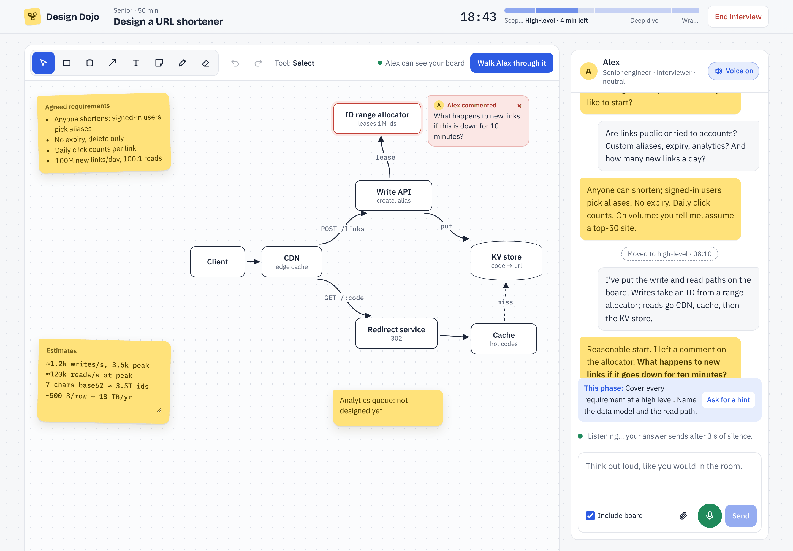
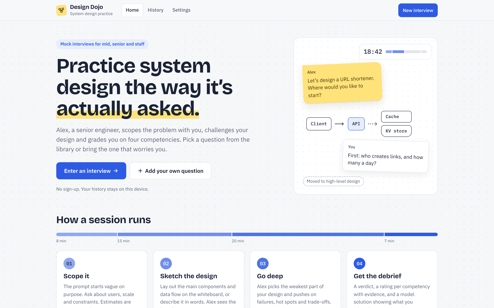
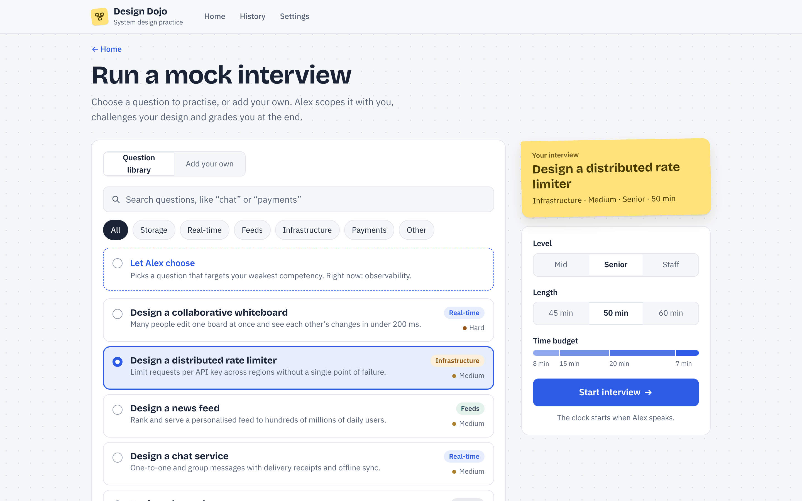
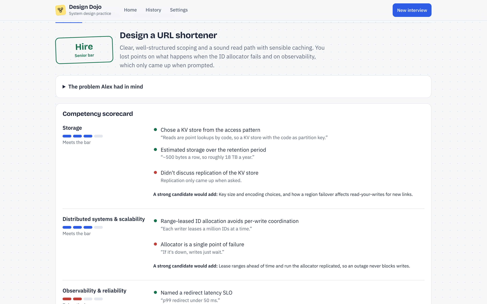
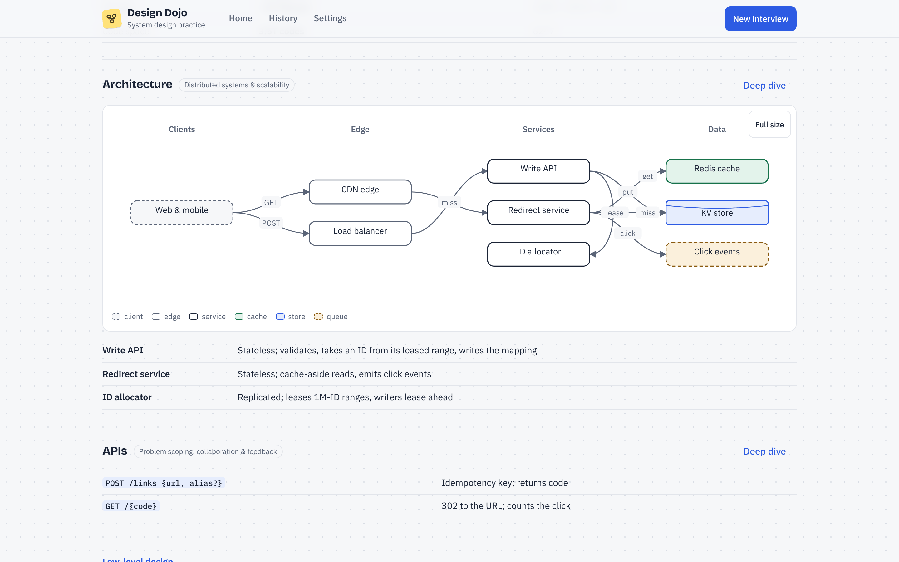
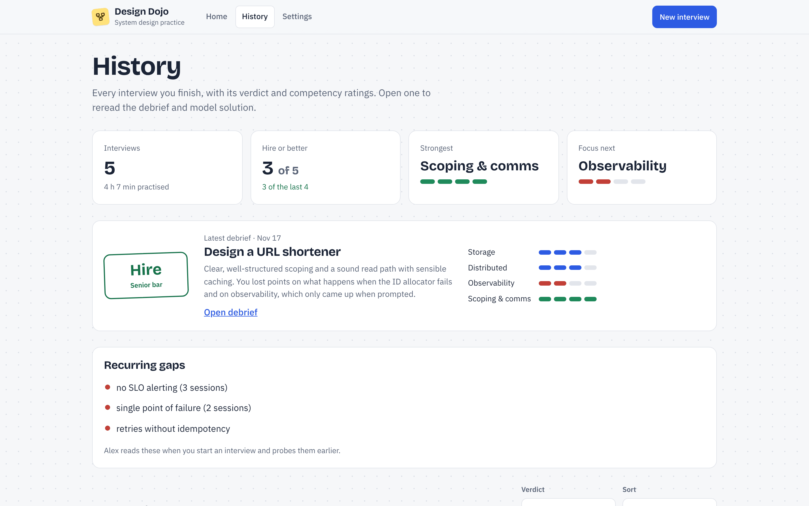
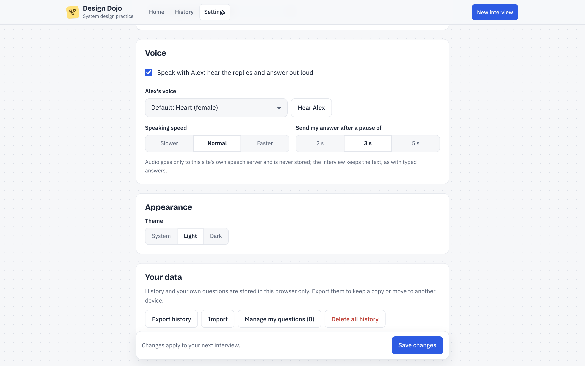
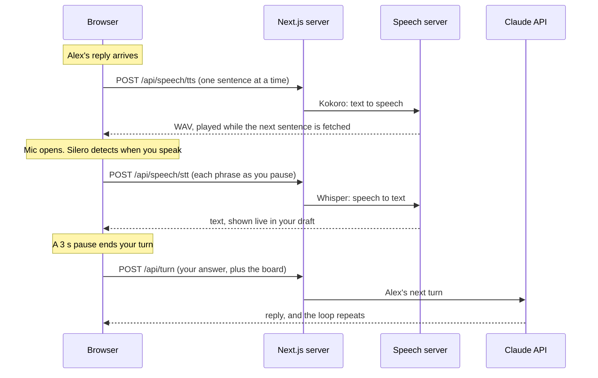

<div align="center">


# Design Dojo

**Practice system design interviews the way they're actually asked.**

An AI interviewer scopes the problem with you, watches your whiteboard, pushes on the weak spots, and grades you on four competencies. Then a principal engineer shows you the model answer. You can do it all out loud.




</div>

## Contents

- [What it is](#what-it-is)
- [Features](#features)
- [How an interview runs](#how-an-interview-runs)
- [Screenshots](#screenshots)
- [Quick start](#quick-start)
- [Voice interviews](#voice-interviews)
- [Question catalog](#question-catalog)
- [Configuration](#configuration)
- [Architecture](#architecture)
- [Cost](#cost)
- [Deploying](#deploying)
- [Scripts](#scripts)
- [Acknowledgements](#acknowledgements)

## What it is

Design Dojo is a mock interview room for system design, for mid, senior and staff engineers.

- **Alex**, a senior engineer, runs the interview. The question starts deliberately vague, Alex answers only what you ask, sees what you draw, and probes the weakest part of your design. At the end, Alex steps out of character and writes an honest, evidence-based debrief.
- **Sam**, a principal engineer, then designs the model solution independently from the agreed scope, compares it with yours, and answers your follow-up questions.

There are no accounts. Your history, settings and custom questions stay in your browser.

## Features

**Interview room**
- A whiteboard with boxes, databases, arrows with labels, text, sticky notes, a pen and an eraser, plus undo/redo, zoom and keyboard shortcuts.
- Alex sees the board as structured text with every message, and can pin a comment to the box being questioned.
- *Agreed requirements* fill in by themselves as Alex answers your scoping questions; *Estimates* is your scratchpad, and Alex reads it too.
- A phase clock with a time budget (scope, design, deep dive, wrap-up) that warns when you run over.
- Ask for a hint, or attach a diagram image.

**Voice interviews** ([details](#voice-interviews))
- Alex speaks every reply, and you answer out loud, hands-free: when Alex finishes, the mic opens, and a short pause sends your answer.
- Skip Alex mid-sentence, pause the mic, or type at any time. Typing pauses auto-send, so nothing is sent from under you.
- Runs on your own speech server with open-source models. Without one, the room works as text.

**Debrief**
- A verdict for your level (Strong Hire to No Hire) and a 1–4 rating for each competency: *Storage*, *Distributed systems & scalability*, *Observability & reliability*, and *Problem scoping, collaboration & feedback*.
- Green and red flags quoting your own words, what a strong candidate would have added, critical misses, the moments that mattered, how you used your time, and the top three things to practise next.
- The problem Alex had in mind, revealed: the real scale, the crux, and how close your scoping got.

**Model solution**
- Designed from the agreed scope without looking at your answer, then compared with it area by area: *matches*, *also valid*, *flawed* or *wrong*.
- Drawn architecture and sequence diagrams, storage and data model, scaling and failure handling, observability, trade-offs, and how each requirement is met.
- A deep dive on any section, plus **Ask Sam**: a spoken 45-minute rehearsal script, a side-by-side table, or an 8-question quiz. Download it all as Markdown.

**Questions**
- A catalog of Markdown files in this repo, each with a hidden spec (scale, crux, curveballs) that only Alex ever sees. A check runs on every push.
- **Let Alex choose** picks a question that targets your weakest competency and avoids the ones you did recently.
- Add your own question, with your own private notes for Alex.

**History and settings**
- A history of every interview with its verdict, ratings, trends and recurring gaps. Reopen any debrief or solution.
- End an interview now and get the debrief later, or end with the debrief straight away.
- Interviewer style (*Supportive*, *Neutral*, *Tough*), rubric flavour (*four competencies*, *big-tech loop*, *startup generalist*), voice options, light and dark themes, and export/import of all your data.

## How an interview runs

| | Phase | Time (50 min) | What happens |
|---|---|---|---|
| 1 | **Scope it** | 8 min | The prompt is vague on purpose. Ask about users, features and scale; the estimates are yours to make. |
| 2 | **Sketch the design** | 15 min | Lay out components and data flow on the board, or describe it out loud. Alex sees the board. |
| 3 | **Go deep** | 20 min | Alex picks the weakest part of your design and pushes on failures, hot spots and trade-offs, with a curveball or two. |
| 4 | **Wrap up** | 7 min | What you'd improve with more time, and your questions for Alex. |
| → | **Debrief and model solution** | 1–3 min | A verdict with evidence, then the model answer and how yours compares. |

The budget scales with the 45, 50 or 60-minute length you pick.

## Screenshots

<table>
  <tr>
    <td width="50%" valign="top"><br><sub><b>Landing.</b> Start an interview or bring your own question.</sub></td>
    <td width="50%" valign="top"><br><sub><b>New interview.</b> The question catalog, Let Alex choose, level and length.</sub></td>
  </tr>
  <tr>
    <td width="50%" valign="top"><br><sub><b>Debrief.</b> A verdict and a competency scorecard that quotes your own answers.</sub></td>
    <td width="50%" valign="top"><br><sub><b>Model solution.</b> A drawn architecture, components and APIs, then the comparison with yours.</sub></td>
  </tr>
  <tr>
    <td width="50%" valign="top"><br><sub><b>History.</b> Ratings over time, recurring gaps, every session.</sub></td>
    <td width="50%" valign="top"><br><sub><b>Settings.</b> Voice on or off, Alex's voice with a preview, speed and pause length.</sub></td>
  </tr>
</table>

## Quick start

You need **Node.js 20.9 or newer** and an **Anthropic API key**. Create the key at [platform.claude.com](https://platform.claude.com) under *Settings → API Keys*; the API is pay-as-you-go, separate from a claude.ai subscription.

```bash
git clone https://github.com/TanmyaC/designdojo.git
```

```bash
cd designdojo && npm install
```

```bash
cp .env.example .env.local
```

Set `ANTHROPIC_API_KEY=sk-ant-…` in `.env.local`, then:

```bash
npm run dev
```

Open http://localhost:3000 and start an interview.

> **No key handy?** For local testing you can sign in with the `ant` CLI (`ant auth login`) instead; the Anthropic SDK picks the sign-in up when `ANTHROPIC_API_KEY` isn't set. A deployed site needs a key.

## Voice interviews

Speech runs on a small server you host, using open-source models, so there's no third-party voice service and no per-use cost. The browser never talks to it directly: the Next.js server sits in between and adds a shared secret.



| Piece | Model | License |
|---|---|---|
| Alex's voice | [Kokoro-82M](https://huggingface.co/hexgrad/Kokoro-82M) | Apache-2.0 |
| Your answers | [Whisper](https://github.com/openai/whisper), via [faster-whisper](https://github.com/SYSTRAN/faster-whisper) | MIT |
| When you've stopped talking | [Silero VAD](https://github.com/snakers4/silero-vad), via [vad-web](https://github.com/ricky0123/vad) | MIT (vad-web: ISC) |

**Set it up**

```bash
cd speech-server && SPEECH_API_KEY=pick-a-long-random-string docker compose up -d --build
```

Then add the same key to `.env.local`, and restart `npm run dev`:

```
SPEECH_URL=http://127.0.0.1:8001
SPEECH_API_KEY=pick-a-long-random-string
```

The first start downloads about 0.8 GB of models. Voice is on by default in the interview room; *Settings → Voice* switches it off, picks Alex's voice (with a preview), sets the speaking speed, and sets the pause that sends your answer (2, 3 or 5 s).

**What to expect on a 4-core CPU** (measured with the default models, no GPU)

| Step | Result |
|---|---|
| Alex's voice | 3–4× faster than real time; the first sentence is ready in under a second |
| Transcribing a 7–10 s answer | 2–3 s, mostly while you're still talking |
| Answer sent after you stop | about 3 s, with the default pause |
| Memory / image / models | about 3 GB RAM, a 3 GB image, 0.8 GB of models |

Whisper is primed with system-design vocabulary, so words like *Redis*, *Cassandra*, *p99* and *read path* come through correctly. Audio is processed in memory and never stored; the interview keeps only the text. Deployment, model choices and troubleshooting: [`speech-server/README.md`](speech-server/README.md).

## Question catalog

Every question is one Markdown file in [`questions/`](questions/), written against [`questions/_TEMPLATE.md`](questions/_TEMPLATE.md). The top is what candidates see; the hidden spec goes only to Alex, on the server.

```markdown
---
title: Design a URL shortener
category: Storage
difficulty: Easy
summary: Create short links, redirect fast, and count clicks at very high read volume.
focus: [storage, scoping]
---

## Opening

Let's design a URL shortener, something like bit.ly. Where would you like to start?

## Hidden spec

### Scale
- 100M new links per day
- Reads to writes 100:1

### Crux
- Unique ID generation: counter ranges, hashing with collision checks, or a pre-generated key pool

### Curveballs
- The ID allocator is down for ten minutes
```

| Field | Seen by | |
|---|---|---|
| `title`, `category`, `difficulty`, `summary` | Candidate | Required |
| `featured`, `levels`, `tags` | Candidate (home page, filters, search) | Optional |
| `focus` | *Let Alex choose*: the 1–2 competencies the question tests hardest | Recommended |
| `## Opening` | Candidate, as Alex's first line | Optional |
| `## Hidden spec` | Alex only; never sent to the browser | Recommended |

To add a question, create it from the template:

```bash
npm run question:new -- "Design a web crawler"
```

Fill in `questions/web-crawler.md`, then validate the catalog:

```bash
npm run questions:check
```

Commit and push. The check also runs before every `npm run build`, and the **Question catalog** GitHub Action runs it on every push and pull request, so a broken question can't reach the site. The 12 built-in questions double as examples. Full rules: [`questions/README.md`](questions/README.md).

## Configuration

All settings are server-side environment variables, in `.env.local` locally or in your host's settings.

| Variable | Required | Purpose |
|---|---|---|
| `ANTHROPIC_API_KEY` | Yes, unless signed in with `ant auth login` | Calls Claude. Never sent to the browser. |
| `CLAUDE_MODEL` | No | Defaults to `claude-sonnet-5-5`. Set `claude-opus-5-5` for Opus. |
| `ACCESS_CODE` | No | Visitors must enter this code before Alex will talk to them. Recommended for any public deployment. |
| `SPEECH_URL` | No | URL of the speech server, e.g. `http://127.0.0.1:8001`. Leave unset for text-only interviews. |
| `SPEECH_API_KEY` | With `SPEECH_URL` | The shared secret the speech server was started with. |
| `LLM_LOG_FILE` | No | Where to write the Claude call log ([Cost](#cost)). Defaults to `logs/llm.jsonl` in development and is off in production unless set. |
| `PROMPT_LAYOUT` | No | Set to `legacy` to send interview turns and Sam's answers as one uncached prompt, the way the app did before prompt caching. Only useful for measuring a baseline. |

## Architecture

```mermaid
flowchart LR
    subgraph Browser
        ui["Pages: landing, new interview,<br/>room, session, history, settings"]
        ls[("localStorage<br/>sessions, settings, questions")]
        ui <--> ls
    end
    subgraph Next["Next.js server"]
        api["API routes<br/>start · turn · debrief · solution · sam"]
        cat["Question catalog<br/>questions/*.md"]
        sp["Speech proxy<br/>status · tts · stt"]
    end
    ui -- "session context per request" --> api
    cat -- "hidden spec" --> api
    api --> claude[("Claude API")]
    ui --> sp --> speech[("Speech server")]
```



The browser holds all state and sends the relevant part of a session with each request; the server builds the prompt and calls Claude. **Nothing is stored server-side**, apart from the optional call log of token counts and timings described under [Cost](#cost), which holds no interview text.

| Route | Does | Claude effort |
|---|---|---|
| `POST /api/start` | Builds the hidden spec (from the catalog, your notes, or *Let Alex choose*) and Alex's opening | medium |
| `POST /api/turn` | One interviewer turn; Alex sees the board and may pin a comment | low (speed matters) |
| `POST /api/debrief` | Verdict and competency scorecard | high |
| `POST /api/solution` | Model solution (`step: "model"`), then the comparison (`step: "cmp"`) | high / medium |
| `POST /api/sam` | Streams deep dives and follow-up answers | medium |
| `/api/speech/*` | Status, text to speech, speech to text (proxied to the speech server) | — |

Every Claude call streams under the hood, so long generations don't time out. If a safety classifier declines a request, it's retried on a fallback model within the same call. Model replies are normalized before rendering, so an unexpected shape can't break a page. Interview turns and Sam's answers use [prompt caching](#prompt-caching), and every call is logged with its tokens, timing and estimated cost.

```
app/                    Pages and API routes
  room/                 Interview room: whiteboard, conversation, phase clock, voice
  session/[id]/         Debrief, model solution, transcript and board
  api/                  start, turn, debrief, solution, sam, speech/{status,tts,stt}
components/             Whiteboard, voice hook (useVoice), shared UI
lib/
  prompts.ts            Prompt builders (text in prompt-text.json)
  claude.ts             Anthropic SDK client: streaming, JSON parsing, errors, fallbacks, call timing
  usage.ts              Price table, cost per call, the llm_call log (usage-shared.ts: totals for the UI)
  catalog*.{ts,mjs}     Reads and validates the question catalog
  voice.ts              Browser voice: playback, voice detection, transcription
  store.ts              localStorage persistence
questions/              Question catalog (one Markdown file per question)
speech-server/          Self-hosted speech service (FastAPI, Kokoro, faster-whisper, Docker)
scripts/                Catalog check, question scaffold, voice-model asset copy,
                        cache layout check, call-log report
```

## Cost

Every interview uses your Anthropic API credits. Before prompt caching, a rough estimate for one 45–60 minute interview, including the debrief and model solution, was **about $1 on Sonnet 5.5** and **about $2 on Opus 5.5**, most of it interview turns. With caching the turns should cost much less; measure your own numbers with the tools below. Set a monthly spend limit on platform.claude.com while you test. Ending an interview without a debrief spends nothing further.

Voice adds no API cost; it runs on your own speech server.

### Seeing what an interview costs

- **In the app:** History has a *Cost (est.)* column, and each session page shows the same figure under its title, for example `$0.14 · 92% cached`. The figure adds up every Claude call for that interview: start, turns, debrief, model solution and Sam. It is an estimate from list prices in `lib/usage.ts`; your invoice is the real number. Interviews from before this feature show "—".
- **Call log:** the server writes one JSON line per Claude call (`"type":"llm_call"`) to its console, and in development to `logs/llm.jsonl`. Each line has the route, session id, turn number, model requested and served, effort, the four token counts, time to first token, total time, outcome (`ok`, `salvaged`, `invalid_json`, `refused`, `truncated`, `rate_limited`, `cancelled` or `error`) and estimated cost. It holds numbers and labels only, never prompt or reply text.
- **Report:** `npm run llm:report` reads the log and prints cost per interview, cost by route and token type, time to first token on `/api/turn` (p50 and p90), cache hit rate by turn, and outcome counts. It warns about any interview that never read from the cache.

### Prompt caching

Each turn would otherwise resend Alex's ~3.5k tokens of instructions, the hidden spec and the whole transcript at full price. `/api/turn` and `/api/sam` now send their prompt in order of how often each part changes, with cache breakpoints between the parts (`lib/prompts.ts`, `turnRequest`, `deepRequest` and `followRequest`):

| Part | Changes | Cache |
|---|---|---|
| Alex's (or Sam's) fixed instructions | never | 1 hour; shared by every interview |
| Style, level, length and hidden spec (Sam: the agreed scope) | once per interview | 1 hour |
| Earlier turns, as real user and assistant messages | grows by one exchange per turn | 5 minutes, on the newest turn |
| Canon facts, time, hints, phase, the new message, the board | every turn | not cached |

A cache read costs 5% of the normal input price on Sonnet 5.5, so from the second turn on, almost all of each turn's input is cheap. The 5-minute entry renews on every turn; after a longer pause only the transcript is written again, because the two 1-hour entries survive.

Caching only works while everything before a breakpoint stays byte-for-byte the same. Keep these rules when you edit a prompt:

- Put anything that changes every turn in the last message, never in the system blocks.
- Never rewrite or re-trim earlier turns; only append.
- Keep one model and one effort level per route.

`npm run check:cache` builds two consecutive turns of a sample interview and fails if their cached parts differ, with no API calls. Run it after any prompt change. To measure the saving, run an interview with `PROMPT_LAYOUT=legacy`, run one without it, and compare them with `npm run llm:report`.

## Deploying

- **The app:** any Node host works. On Vercel: import the repo, add the environment variables, deploy. API routes allow up to 300 s, since a debrief or model solution can take one to three minutes. Set `ACCESS_CODE` if the site is public.
- **The speech server (optional):** run it on a VM behind HTTPS (for example with Caddy or nginx) with a long random `SPEECH_API_KEY`, and point `SPEECH_URL` at it. Browsers only allow the microphone on `https://` pages or `localhost`. See [`speech-server/README.md`](speech-server/README.md).

## Scripts

| Command | Does |
|---|---|
| `npm run dev` | Development server on http://localhost:3000 |
| `npm run build` | Validates the question catalog, then builds for production |
| `npm start` | Serves the production build |
| `npm run lint` | Type-checks the project (`tsc --noEmit`) |
| `npm run questions:check` | Validates every file in `questions/` |
| `npm run question:new -- "Design …"` | Creates a new question from the template |
| `npm run check:cache` | Checks the cached prompt layouts stay stable from turn to turn (no API calls) |
| `npm run llm:report` | Summarises the Claude call log: cost, time to first token, cache hit rate, outcomes |

## Acknowledgements

- Designed in [Claude Design](https://claude.ai) and built on the [Claude API](https://platform.claude.com).
- Voice by [Kokoro](https://huggingface.co/hexgrad/Kokoro-82M), [Whisper](https://github.com/openai/whisper) / [faster-whisper](https://github.com/SYSTRAN/faster-whisper) and [Silero VAD](https://github.com/snakers4/silero-vad).
- Fonts: [Bricolage Grotesque](https://fonts.google.com/specimen/Bricolage+Grotesque) and [IBM Plex](https://www.ibm.com/plex/).
